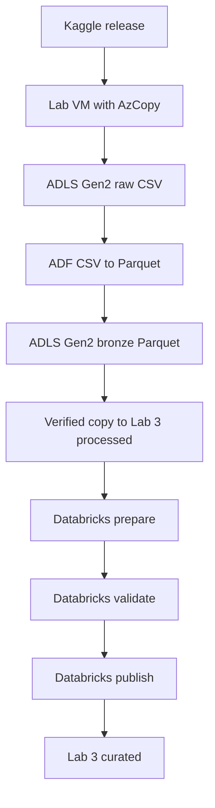

# DSAI3202 Phase 1 Stock Close Forecast

The pipeline takes the Kaggle stock history through versioned ingestion, quality checks, full-population profiling and initial forecasting features. The files to run in Azure are `phase1_pipeline.py`, `project.json` and `fixtures/quality_test.parquet`. Use the Azure steps below to capture the assessed evidence.

## Project and hypothesis

**Phase 0 project:** Forecasting Analysis for Stock Market. The submitted hypothesis reads “Provide investor/seller predictions to buy/sell a stock from which company at which time to increase their gains and lessen their loss, under changeable market stock prices condition.” Daily `Close` was the stated regression target.

**Proposed Phase 1 refinement:** For ticker and trading date *t*, make a prediction once that date’s opening price is available. A regression model that uses the opening price and strictly earlier observations should achieve lower mean absolute error (MAE) for the same date’s `Close` than the baseline **predicted close = opening price** on a held-out chronological test period. Endpoint use would be a pre-close estimate for a user reviewing daily price movements.

The timing makes the experiment testable and avoids using the completed day’s high, low or total volume. The target and source are carried over from Phase 0. Record the refinement and confirmation status in the submission. Compare both methods on identical test rows and split by dates across all tickers. Use earlier dates for training, the next block for validation and the latest block for testing. Fit preprocessing using training data only. Report MAE as forecasting evidence. A claim about trading gains would need a separate evaluation of trades and costs.

## Dataset and architecture

**Source:** Jake Wright, *9000+ Tickers of Stock Market Data (Full History)*, Kaggle release 2, dated 13 November 2024. The Phase 0 data source, release and regression target are retained. Phase 1 uses the publisher's full **`all_stock_data.csv`** file and converts it to bronze Parquet in ADF. Record the format refinement and its confirmation status in the submission.

- [Kaggle dataset page](https://www.kaggle.com/datasets/jakewright/9000-tickers-of-stock-market-data-full-history?select=all_stock_data.csv)
- [Direct CSV download](https://www.kaggle.com/api/v1/datasets/download/jakewright/9000-tickers-of-stock-market-data-full-history/all_stock_data.csv)
- [Kaggle file listing API](https://www.kaggle.com/api/v1/datasets/list/jakewright/9000-tickers-of-stock-market-data-full-history)

The original CSV has **3,512,208,588 bytes** (3.512 GB uncompressed) and **34,646,258 data records**. The [verified source manifest](evidence/local_source_manifest.json) records the exact byte count, headers and SHA-256. Kaggle lists Yahoo as the data source and “Other (specified in description)” as the license in its [metadata](https://www.kaggle.com/api/v1/datasets/metadata/jakewright/9000-tickers-of-stock-market-data-full-history). Keep the original file in Azure and link the publisher from Git.

| CSV columns | Bronze Parquet columns | Clean types |
| --- | --- | --- |
| `Date`, `Ticker` | `Date`, `Ticker` | Date, string |
| `Open`, `High`, `Low`, `Close` | Same names | Double |
| `Volume`, `Dividends`, `Stock Splits` | `Volume`, `Dividends`, `Stock_Splits` | Double |

ADF writes all nine bronze fields as strings. Databricks performs type conversion alongside its row-level gate so casting errors appear in the audit. The underscore in `Stock_Splits` satisfies the ADF Parquet connector's column naming requirement.



The refresh is a manual batch for each selected Kaggle release. ADLS retains the original CSV under `raw/stock_phase1/releases/<CSV_SHA>/all_stock_data.csv`. ADF writes the derived bronze file to `processed/stock_phase1/bronze_csv/<CSV_SHA>/all_stock_data.parquet`. The VM verifies the raw receipt and copies the Parquet into the existing Lab 3 lake. It verifies both Parquet copies with SHA-256 and saves the handoff receipt. Databricks verifies the staged file, checks its schema and full row count, and saves outputs under the project prefix on the lab lake. The published catalog entry links the ingestion and ADF evidence, the clean Delta, and the features.

## Run the pipeline

Use the Phase 1 brief and your instructor's directions to select the project resource group and services. The labs supply the procedures for Azure CLI, AzCopy, Data Factory and Databricks. Allow about **4–6 hours of hands-on work**, with extra elapsed time for a 3.512 GB CSV transfer and its Azure conversion.

| Course lab | Procedure reused |
| --- | --- |
| Lab 3 | Use an Ubuntu VM, AzCopy and ADLS Gen2 for content-addressed raw ingestion and verification. |
| Lab 4 | Use ADF Copy to convert the CSV to Parquet. Record the pipeline run ID and copied row count. |
| Labs 5–6 | Use Databricks to cast fields, clean to Delta, validate and publish. Keep rerun and controlled-failure evidence. |
| Lab 7 | Save versioned feature Parquet and a feature definition with key, type and prediction-time rules. |

### 1. Download and ingest the original CSV

Use the Ubuntu VM from the course as your terminal. Run from the project folder. The destination is the storage account designated for this project. Make sure the account uses ADLS Gen2 and has `raw`, `processed` and `curated` containers. Allow space for the 3.512 GB download and one temporary verification copy.

```bash
mkdir -p local-data evidence/azure

curl --fail --location --retry 3 --continue-at - \
  "https://www.kaggle.com/api/v1/datasets/download/jakewright/9000-tickers-of-stock-market-data-full-history/all_stock_data.csv" \
  -o local-data/all_stock_data.csv.part \
  && mv local-data/all_stock_data.csv.part local-data/all_stock_data.csv

printf '%s  %s\n'   'f29b6abf161eeb97832f1d7ae918e7fe3b67c54334a342710bdb5c48ccb45f98'   'local-data/all_stock_data.csv' | sha256sum -c -
```

Wait for `OK`. Sign in to your course account, set the designated destination and run the upload.

```bash
az login --use-device-code
export SA="YOUR_PROJECT_STORAGE_ACCOUNT"
export STOCK_SHA="$(sha256sum local-data/all_stock_data.csv | cut -d ' ' -f 1)"
set -o pipefail

bash azure/stage_source.sh "$SA" local-data/all_stock_data.csv 2>&1 \
  | tee evidence/azure/raw_upload_first.log
```

Keep the receipt with the SHA-256, bytes and exact Azure path. The upload script uses `--overwrite=false` and verifies the downloaded raw bytes. To demonstrate a safe rerun, use the same SHA and capture the path, ETag, last modified and bytes before and after. Both snapshots should show one CSV and match.

```bash
raw_snapshot() {
  az storage blob list --account-name "$SA" --container-name raw \
    --prefix "stock_phase1/releases/$STOCK_SHA/" --auth-mode login \
    --query "[].{name:name,etag:properties.etag,modified:properties.lastModified,bytes:properties.contentLength}" \
    -o json
}

raw_snapshot > evidence/azure/raw_before_rerun.json
bash azure/stage_source.sh "$SA" local-data/all_stock_data.csv 2>&1 \
  | tee evidence/azure/raw_upload_rerun.log
raw_snapshot > evidence/azure/raw_after_rerun.json
diff -u evidence/azure/raw_before_rerun.json evidence/azure/raw_after_rerun.json
```

### 2. Convert CSV to Parquet in Azure Data Factory

Open the project factory in ADF Studio. Use an ADLS Gen2 linked service named `ls_stock_lake` with its system-assigned managed identity, and test the connection to the **project** lake. The identity needs access to read raw and write processed. If the linked-service name differs, edit both dataset JSON files. Run these commands from the VM using the project's Azure names.

```bash
export RG="YOUR_PROJECT_RESOURCE_GROUP"
export FACTORY="YOUR_PROJECT_DATA_FACTORY"
az extension add --name datafactory

az datafactory dataset create -g "$RG" --factory-name "$FACTORY" \
  --name ds_stock_phase1_csv --properties @azure/adf/dataset.json

az datafactory dataset create -g "$RG" --factory-name "$FACTORY" \
  --name ds_stock_phase1_parquet --properties @azure/adf/parquet_dataset.json

az datafactory pipeline create -g "$RG" --factory-name "$FACTORY" \
  --name pl_stock_phase1_csv_to_parquet --pipeline @azure/adf/pipeline.json

az datafactory pipeline create-run -g "$RG" --factory-name "$FACTORY" \
  --name pl_stock_phase1_csv_to_parquet --parameters "{\"release_sha256\":\"$STOCK_SHA\"}"
```

In **ADF Studio → Monitor**, wait for `ConvertCsvToParquet` to succeed. Save its run ID and confirm **34,646,258 rows read and copied**, with no skipped rows. Repeating the same SHA should skip conversion when the output exists. If the initial copy fails and leaves an incomplete file, inspect its status and remove only that incomplete processed Parquet before retrying. Keep the raw CSV. Databricks checks the converted file's footer and row count before it can publish. [ADF consistency verification](https://learn.microsoft.com/en-us/azure/data-factory/copy-activity-data-consistency) · [ADF Parquet connector](https://learn.microsoft.com/en-us/azure/data-factory/format-parquet)

### 3. Stage the ADF Parquet for the Lab 5 Databricks workspace

[Lab 5](https://chatgpt.com/library?file_id=libfile_3e8dc363bcb481919656012d6ae13885&account_id=personal) and [Lab 6](https://chatgpt.com/library?file_id=libfile_4d5f2f2f5364819180a0cebd997e7052&account_id=personal) read and write the existing Lab 3 lake through governed ADLS paths. Use the course workspace `dsai3202-databricks`, your existing `dsai3202-lab5-60100358` compute, and the lab lake `amazonlake60100358`. The project CSV and ADF output stay in the separate project account. The stock notebook reads a byte-verified copy of the ADF Parquet from the lab lake under `processed/stock_phase1/`.

Run the handoff on the Ubuntu VM from the repository root. It uses your Azure CLI login and the evidence already saved by the raw ingestion and ADF steps.

```bash
cd ~/DSAI3202_Stock_Phase1
bash azure/stage_databricks_input.sh stockforcasting60100358 amazonlake60100358
```

The VM account needs read access to the original project blobs and write access to the lab `processed` container. The script checks the raw rerun evidence and ADF row counts, makes one server-side Parquet copy with overwrite disabled, and compares SHA-256 across the two Parquet objects. It downloads one Parquet copy at a time for verification, so allow an additional 2.18 GB of VM disk space. It also uploads the job config, test fixture and handoff receipt to content-versioned paths. The final **`LAB_HANDOFF_READY`** message prints the exact job parameters. Save [the handoff script](azure/stage_databricks_input.sh), the generated `evidence/azure/databricks_lab_handoff.json`, and `evidence/azure/databricks_lab_parameters.json`. [Cross-account AzCopy](https://learn.microsoft.com/en-us/azure/storage/common/storage-use-azcopy-blobs-copy)

If Azure denies access, use the error to identify whether the named account is the project lake or the lab lake. The Databricks workspace uses the existing Unity Catalog access to the lab `processed` and `curated` external locations. File-path listings and JSON reports use `dbutils.fs`, while Spark reads the Parquet and writes the clean data, quarantine and features. [Databricks file utilities](https://learn.microsoft.com/en-us/azure/databricks/dev-tools/databricks-utils)

### 4. Create the Lab 6 Databricks job

In **Compute**, start your existing `dsai3202-lab5-60100358` compute and keep the course policy settings. In **Workspace**, import the updated `phase1_pipeline.py` as a Python notebook under your `DSAI3202_Phase1` folder. In **Jobs & Pipelines**, create the three Notebook tasks below. All three point to that same notebook and attach to that same compute. Keep one concurrent run, zero task retries and no schedule. [Databricks notebook tasks](https://learn.microsoft.com/en-us/azure/databricks/jobs/notebook)

| Task | Task-level `stage` | Dependency |
| --- | --- | --- |
| prepare | `prepare` | Starts first |
| validate | `validate` | prepare succeeded |
| publish | `publish` | validate succeeded |

For each task, set `run_id` to `job-{{job.run_id}}`. Add the job parameters from `evidence/azure/databricks_lab_parameters.json` under `job_parameters`. Commit the exact notebook and config your job will use and replace the code version placeholder with the value from `git rev-parse HEAD`. [The job JSON](job.example.json) provides the matching task structure.

| Job parameter | Source or value |
| --- | --- |
| `config_path` | Handoff output, versioned project JSON in lab processed |
| `landing_path` | Handoff output, byte-verified stock Parquet in lab processed |
| `handoff_path` | Handoff output, versioned receipt in lab processed |
| `processed_root` | `abfss://processed@amazonlake60100358.dfs.core.windows.net/stock_phase1/silver` |
| `root_path` | `abfss://curated@amazonlake60100358.dfs.core.windows.net/stock_phase1/project_data` |
| `scenario` | `full` |
| `code_version` | Git SHA of the deployed notebook and config |
| `clean_format` | `delta` |
| `adf_run_id` | Handoff output, first successful ADF conversion ID |

**Full run.** Start the job with the defaults. The notebook checks the staged file metadata against the handoff and verifies the Spark input count against all **34,646,258** source rows. Save the run ID, manifest, `quality.json`, `gate.json`, `eda.json`, `run.json` and the published catalog entry. The catalog entry gives the clean Delta and feature Parquet paths. For a Unity Catalog table like in Lab 5, register the completed Delta path with `CREATE TABLE dsai3202_databricks.s_60100358.stock_close_silver USING DELTA LOCATION '<clean Delta path from catalog entry>'` if you have the table-creation grants. The catalog JSON supplies the equivalent documented metadata required for Phase 1.

**Safe rerun.** Run the job with the same inputs and code SHA. The run report should show `ingestion=reused` and `status=reused`, pointing to the same input and output versions and original output paths.

**Controlled failure.** Choose **Run now with different parameters**. Set `scenario=quality_test`, change `landing_path` to `quality_test_landing_path` from the handoff output, and clear `adf_run_id` for that run. Keep `handoff_path` so the notebook can verify the fixture. Prepare should succeed with the quarantine report, validate should reject all four fixture records, and publish should be skipped. [Databricks run overrides](https://learn.microsoft.com/en-us/azure/databricks/jobs/run-now)

Export the deployed ADF and Databricks definitions as small, reviewed evidence files. Save the Databricks job JSON from **View as code** in the job UI. The ADF Copy pipeline can be exported from the VM with:

```bash
az datafactory pipeline show -g rg-dsai3202-jahan-60100358 \
  --factory-name adf-dsai3202-60100358 \
  --name pl_stock_phase1_csv_to_parquet -o json > evidence/azure/adf.pipeline.export.json
```


### 5. Check locally if needed

Use Python 3.11 or 3.12 and an appropriate Java runtime such as Java 17. The fixture runs locally with Parquet; Azure uses Delta.

```bash
python -m pip install -r requirements-local.txt
python verify_fixture.py
```

To check the CSV conversion and pipeline locally, first use the included PyArrow converter. This reproduces the ADF column and string-type mapping. Use the Azure run as the course submission evidence.

```bash
python local_convert_csv.py local-data/all_stock_data.csv local-output/bronze/all_stock_data.parquet
PYSPARK_SUBMIT_ARGS='--driver-memory 4400m pyspark-shell' python phase1_pipeline.py \
  --config-path project.json --landing-path local-output/bronze/all_stock_data.parquet \
  --preserved-source-path local-data/all_stock_data.csv --root-path local-output \
  --scenario full --run-id local-csv-full-01 --code-version stock-csv-phase1-v1 \
  --local-threads 4 --local-shuffle-partitions 64
```

## Results and features

The pipeline validates keys, labels and required prices. It quarantines nonpositive prices, inconsistent OHLC ranges beyond a small rounding tolerance, negative optional numeric fields, and invalid values. Exact normalized duplicates retain one row. Valid rows that disagree for the same ticker and date are quarantined together. The provisional quality gate fails on zero accepted rows or a reject fraction above **10%**. Review overall and yearly losses when judging fitness for the experiment. Preserve the full input first so early coverage or anomaly investigations remain possible.

EDA uses every accepted row. The full local run processed **34,646,258** source rows, retained **33,451,152** across **9,311** tickers, and quarantined **1,195,106** (3.45%). The most common reject combination (1,191,197 rows) was a nonpositive price and an inconsistent price range. The raw snapshot retains those rows for review.

- The median reported `Close` is about 11.55, with an approximate interquartile range of 3.77–29.20. The maximum is approximately 1.51 × 10²⁸. The observed Open–Close Pearson coefficient rounds to 1.0. Investigate the extreme values and price adjustment policy before relying on pooled correlations or a pooled price MAE.
- There are 4,537,809 accepted zero-volume rows. Price forecasts on these rows may have a different interpretation from forecasts on actively traded observations. Report the volume mix and compare periods when evaluating the model.
- The five-observation trailing mean is missing in 46,515 rows while it accumulates enough history. Track this when comparing model and baseline so both are evaluated on the same rows.

See [local quality](evidence/local_quality.json), [local EDA](evidence/local_eda.json) and [local run comparison](evidence/local_run_comparison.json). Add actual Azure evidence below.

| Azure run | IDs and links | Input and output version | Input / accepted / rejected |
| --- | --- | --- | --- |
| ADF full conversion | `2f2598ba-e1ba-11f1-9bcb-70a8a53d4b1a` | CSV SHA-256 → bronze Parquet | 34,646,258 read and copied |
| ADF rerun | `ec38cf96-e1bd-11f1-9bcb-70a8a53d4b1a` | Same CSV and bronze file | Existing Parquet reused |
| Databricks full | [Databricks] | [versions] | [counts] |
| Databricks rerun | [Databricks] | [same versions] | [counts] |
| Controlled failure | [Databricks] | [fixture version and no published output] | [counts] |

| Model input | Type | Definition | Availability |
| --- | --- | --- | --- |
| `open_price` | Double | Same date's opening price | At prediction time |
| `previous_close` | Double | Latest strictly earlier accepted close for the ticker | After the earlier session closes |
| `mean_close_previous_5` | Double | Mean of five prior accepted closing prices. Null until five are available. | After the preceding sessions close |
| `previous_range_fraction` | Double | Earlier session's `(High − Low) / Close` | After the earlier session closes |
| `log_previous_volume` | Double | `log(1 + Volume)` for the earlier accepted session | After the earlier session closes |

Keep `ticker` and `date` for identification and chronological splitting. The same-day `Close` is stored as `label` for training and evaluation. Same-day High, Low, Volume, Dividends and Stock Splits are retained in clean data and excluded from the features. Earlier valid rows can skip holidays, missing days or quarantined days. Initial lag values remain missing for tickers with little recorded history. Verify whether the release restates historical prices after corporate actions. The dataset fields do not identify currencies, exchanges, or ticker reuse. Evaluate across date periods and ticker groups with these limitations in mind. The historical model-ready rows have a valid completed price bar. A live forecasting service would encounter some missing or suspect bars before it could assess that day’s final label.

## Resource use and contributions

The Azure Data Factory run reported **2,182,524,492 bytes** written to Parquet, about **37.9% less** than the original 3,512,208,588-byte CSV. The Databricks handoff adds one verified Parquet copy to the Lab 3 lake so the job can use the course's existing storage access. Databricks reuses its clean and feature output on a safe rerun. Terminate your course Databricks compute and deallocate the VM after the checks. Keep ADF triggers and Data Flow debug off for this manual workflow. Retain the project data and evidence needed by the instructor.

Record the work each team member actually performed, including dataset verification, cloud configuration, code changes and review of run results. The notebook builds on the previously generated Phase 1 starter and uses the workflow concepts from Labs 3–7. Document any course lab code copied during your own changes.

Submit the GitHub or course Azure Repos link in D2L. Grant the instructor access to the repository and relevant Azure files, record the submitted commit, and check the D2L deadline. Keep the public download link, manifest, source, configuration, run instructions and small evidence files in Git. Leave large source and generated tables in Azure.

For a new repository, create an empty remote first, then run these commands from the project folder. The first commit is the one to use as `code_version` for the Azure job. Commit your Azure evidence and final README afterwards.

```powershell
git init -b main
git add .
git commit -m "Build stock forecasting Phase 1 data pipeline"
git rev-parse HEAD
git remote add origin "YOUR_REPOSITORY_URL"
git push -u origin main
```

## AI use

| Tool | Request | Response | My changes and verification |
| --- | --- | --- | --- |
| ChatGPT | Turn my Phase 0 stock project into Phase 1 code and run instructions. | Adapted the pipeline, verified the selected CSV and added the ADF conversion, formulated a testable hypothesis and baseline, added stock-specific quality rules and trailing features, added AzCopy and ADF deployment definitions, split the Databricks job into three tasks, adapted it to the Lab 5 and 6 paths, and tested the code locally. | [Add the changes you made, the runs you performed in Azure and how you verified them.] |
