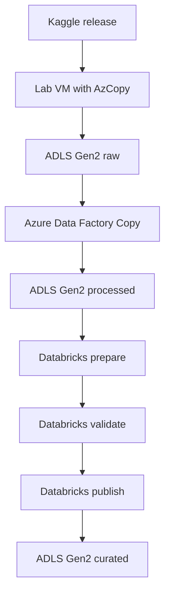

# DSAI3202 Phase 1 Stock Close Forecast

The pipeline takes the Kaggle stock history through versioned ingestion, quality checks, full-population profiling and initial forecasting features. The files to run in Azure are `phase1_pipeline.py`, `project.json` and `fixtures/quality_test.parquet`. Use the Azure steps below to capture the assessed evidence.

## Project and hypothesis

**Phase 0 project:** Forecasting Analysis for Stock Market. The submitted hypothesis reads “Provide investor/seller predictions to buy/sell a stock from which company at which time to increase their gains and lessen their loss, under changeable market stock prices condition.” Daily `Close` was the stated regression target.

**Proposed Phase 1 refinement:** For ticker and trading date *t*, make a prediction once that date’s opening price is available. A regression model that uses the opening price and strictly earlier observations should achieve lower mean absolute error (MAE) for the same date’s `Close` than the baseline **predicted close = opening price** on a held-out chronological test period. Endpoint use would be a pre-close estimate for a user reviewing daily price movements.

The timing makes the experiment testable and avoids using the completed day’s high, low or total volume. The target and source are carried over from Phase 0. Record the refinement and confirmation status in the submission. Compare both methods on identical test rows and split by dates across all tickers. Use earlier dates for training, the next block for validation and the latest block for testing. Fit preprocessing using training data only. Report MAE as forecasting evidence. A claim about trading gains would need a separate evaluation of trades and costs.

## Dataset and architecture

**Source:** Jake Wright, *9000+ Tickers of Stock Market Data (Full History)*, Kaggle dataset release 2, dated 13 November 2024. The selected `all_stock_data.parquet` is the Parquet file linked in Phase 0. The listing also reports a 3,512,208,588-byte CSV. Use the complete selected Parquet file once.

- [Kaggle dataset page](https://www.kaggle.com/datasets/jakewright/9000-tickers-of-stock-market-data-full-history?select=all_stock_data.parquet)
- [Direct Parquet download](https://www.kaggle.com/api/v1/datasets/download/jakewright/9000-tickers-of-stock-market-data-full-history/all_stock_data.parquet)
- [Kaggle file listing API](https://www.kaggle.com/api/v1/datasets/list/jakewright/9000-tickers-of-stock-market-data-full-history)
- [Kaggle metadata API](https://www.kaggle.com/api/v1/datasets/metadata/jakewright/9000-tickers-of-stock-market-data-full-history)

The selected file contains **34,646,258 rows** across **34 Parquet row groups**, from **1962-01-02 to 2024-11-04**. The stored file is **962,269,317 bytes** (0.962 GB). The Parquet footer reports **1,166,056,332 uncompressed bytes** (1.166 GB, sum of the uncompressed encoded column chunks in each row group). The [verified source manifest](evidence/local_source_manifest.json) records the date bounds, source file SHA-256 and exact sizes. Kaggle lists Yahoo as the source and the license as “Other (specified in description).” Keep the raw dataset in the course workspace and link to the publisher from Git.

| Source columns | Clean types | Purpose |
| --- | --- | --- |
| `Date`, `Ticker` | Date, string | Candidate composite key and history ordering within ticker |
| `Open`, `High`, `Low`, `Close` | Double | Prices as supplied. Close is the historical target. |
| `Volume`, `Dividends`, `Stock Splits` | Double | Trading activity and actions as supplied. Optional nulls are retained. |



The refresh is a manual batch. ADLS stores the preserved original at a content-addressed raw path, the ADF copy and clean Delta under processed, and features, reports and catalog metadata under curated. The Databricks prepare task checks both file hashes and writes the manifest. Each run creates its own evidence folder. The catalog entry is committed only after validation and output row-count checks, and serves as the schema and lineage record. Unity Catalog governs access using the three external volumes. The full and controlled test runs use separate namespaces.

## Run the pipeline

Allow about **4–6 hours of hands-on work** if you can reuse the course VM, lake, factory and Databricks compute. Dataset transfer, compute runtime and permission setup add elapsed time. Start by reusing the resources from your lab instructions.

| Course practice | Phase 1 implementation |
| --- | --- |
| Labs 2–3 | SSH to the course Ubuntu VM. Use Azure CLI and AzCopy with the existing ADLS Gen2 lake. Preserve and hash the raw file. |
| Lab 4 | Use ADF Studio and the existing `ls_lake` managed identity linked service. Run the parameterized Copy activity on Azure Integration Runtime. |
| Lab 5 | Use Databricks PySpark to type-check and clean the staged Parquet, account for rejected rows, and save clean Delta. |
| Lab 6 | Use a Databricks Jobs dependency chain with prepare, validate and publish. The controlled test makes validate fail and skips publish. |
| Lab 7 | Save versioned feature Parquet and a feature specification with entity key, data types and prediction-time rules. The Phase 1 brief allows this implementation without a managed Azure ML feature store. |

### 1. Stage the source from the Lab 2 VM

Open the course VM and connect via SSH. Put this project folder on the VM, then run these commands from the folder. Use your own existing Azure resource names. The lab example names follow `amazonlakeYOUR_ID` and `adf-dsai3202-YOUR_ID`.

```bash
az login --use-device-code
az account show --query '{subscription:name, tenant:tenantId}' -o table
export SA="$(cat ~/.dsai3202_lake)"
mkdir -p local-data evidence/azure
curl --fail --location "https://www.kaggle.com/api/v1/datasets/download/jakewright/9000-tickers-of-stock-market-data-full-history/all_stock_data.parquet" -o local-data/all_stock_data.parquet
sha256sum local-data/all_stock_data.parquet
bash azure/stage_source.sh "$SA" local-data/all_stock_data.parquet | tee evidence/azure/raw_upload.log
export STOCK_SHA="$(sha256sum local-data/all_stock_data.parquet | cut -d ' ' -f 1)"
```

Compare the SHA-256 to [the verified source manifest](evidence/local_source_manifest.json). If your setup has no `~/.dsai3202_lake`, set `SA` to your existing lab storage account. If Kaggle presents a sign-in page, download the Parquet file through Kaggle and transfer the file to the VM. The script verifies the remote bytes, including when AzCopy skips an existing file on a rerun. The Azure CLI login needs data access to the course lake. [AzCopy authorization](https://learn.microsoft.com/en-us/azure/storage/common/storage-use-azcopy-authorize-user-identity)

### 2. Set up Azure Data Factory as in Lab 4

Open the existing data factory. Confirm its system-assigned managed identity can access the lake and the existing linked service `ls_lake` passes **Test connection**. The lab’s instructor grants the required storage data role. If using another linked-service name, update the dataset definition. Deploy from the VM with the Azure CLI Data Factory extension:

```bash
export RG="YOUR_EXISTING_LAB_RESOURCE_GROUP"
export FACTORY="YOUR_EXISTING_DATA_FACTORY"
az extension add --name datafactory
az datafactory dataset create -g "$RG" --factory-name "$FACTORY" \
  --name ds_stock_phase1_binary --properties @azure/adf/dataset.json
az datafactory pipeline create -g "$RG" --factory-name "$FACTORY" \
  --name pl_stock_phase1_bronze --pipeline @azure/adf/pipeline.json
az datafactory pipeline create-run -g "$RG" --factory-name "$FACTORY" \
  --name pl_stock_phase1_bronze --parameters "{\"release_sha256\":\"$STOCK_SHA\"}"
```

In **ADF Studio → Monitor**, open your run ID and wait for **Succeeded**. The Binary Copy copies the existing Parquet bytes from `raw/stock_phase1/releases/<sha>/` to `processed/stock_phase1/bronze/<sha>/`. The second ADF run with the same SHA observes that the destination exists and skips the Copy activity. Capture those two statuses. Databricks recomputes both SHA-256 hashes before processing the copy. If it reports a mismatch, inspect and repair the ADF staging file for that SHA before rerunning. The raw release stays available for replay. [ADF consistency verification](https://learn.microsoft.com/en-us/azure/data-factory/copy-activity-data-consistency) · [ADF CLI](https://learn.microsoft.com/en-us/cli/azure/datafactory/pipeline)

The source is already flat Parquet. ADF handles transfer in this design, and Databricks handles all row transformations. That uses the Lab 4 Copy pattern and avoids a second Spark transformation.

### 3. Connect Databricks to the lab lake

Use the existing workspace, assigned Unity Catalog and schema (the lab names are `dsai3202_databricks` and `s_YOUR_ID`), and the smallest course-approved Unity Catalog compute with enough memory for the data. Databricks Runtime 16.4 LTS includes Spark, Delta Lake and PyArrow.

Have the instructor grant access to or create the three external volumes below over the lab’s existing external locations. To create an external volume you need the appropriate `CREATE VOLUME` and `CREATE EXTERNAL VOLUME` privileges. The Job’s Run as identity needs `USE CATALOG`, `USE SCHEMA`, and `READ VOLUME` on all three, plus `WRITE VOLUME` on processed and curated. If an external location already exists for a container, use it when creating the subdirectory volume. [External volume setup](https://learn.microsoft.com/en-us/azure/databricks/volumes/utility-commands) · [Volume permissions](https://learn.microsoft.com/en-us/azure/databricks/volumes/privileges)

| Volume | Location in your ADLS account |
| --- | --- |
| `stock_raw` | `abfss://raw@SA.dfs.core.windows.net/stock_phase1` |
| `stock_processed` | `abfss://processed@SA.dfs.core.windows.net/stock_phase1` |
| `stock_curated` | `abfss://curated@SA.dfs.core.windows.net/stock_phase1` |

Replace `SA` above with the storage account name. See [the SQL example](azure/volumes.example.sql) if you create the volumes in Databricks SQL. Upload `project.json` to `stock_curated/config/project.json` and the included `fixtures/quality_test.parquet` to `stock_curated/fixtures/quality_test.parquet`. The bronze file is already visible through `stock_processed` once ADF succeeds.

### 4. Import the notebook and create the Lab 6 job

Import `phase1_pipeline.py` as a Python notebook under **Workspace → DSAI3202_Phase1**. In **Jobs & Pipelines**, create the three Notebook tasks below, all on the same course-approved compute and pointing at that same notebook. Set run concurrency to 1 and retries to 0. Keep the schedule off. [Databricks notebook tasks](https://learn.microsoft.com/en-us/azure/databricks/jobs/notebook)

| Task | Task-level `stage` | Dependency |
| --- | --- | --- |
| prepare | `prepare` | Starts first |
| validate | `validate` | prepare succeeded |
| publish | `publish` | validate succeeded |

Set task parameter `run_id` to `job-{{job.run_id}}` in each task. Use these job parameters, replacing `V` with `/Volumes/<catalog>/<schema>` and `SHA` with the recorded SHA-256. The [job JSON](job.example.json) provides all tasks and parameters for `databricks jobs create --json @job.json` after substitution.

| Job parameter | Value |
| --- | --- |
| `config_path` | `V/stock_curated/config/project.json` |
| `landing_path` | `V/stock_processed/bronze/SHA/all_stock_data.parquet` |
| `preserved_source_path` | `V/stock_raw/releases/SHA/all_stock_data.parquet` |
| `processed_root` | `V/stock_processed/silver` |
| `root_path` | `V/stock_curated/project_data` |
| `scenario` | `full` |
| `code_version` | `git rev-parse HEAD` from the code commit matching the notebook |
| `clean_format` | `delta` |
| `adf_run_id` | First successful ADF copy run ID |

For the **full run**, start the job using the defaults. Save the ADF and Databricks run IDs, the manifest, `quality.json`, `gate.json`, `eda.json`, `run.json`, and the catalog entry. The catalog entry gives the exact paths of the clean Delta data and curated features. The Delta directory should contain `_delta_log`.

For the **safe rerun**, run ADF again with the same SHA and verify the Copy branch skipped. Run Databricks again with the same input, code and settings. The reports should show `ingestion=reused` and `status=reused`, with the same input, output, row counts and original output paths. Each attempt keeps its own run report.

For the **controlled failure**, choose **Run now with different parameters**. Set `scenario=quality_test`, use `V/stock_curated/fixtures/quality_test.parquet` as `landing_path`, and clear `preserved_source_path` and `adf_run_id`. Prepare should succeed with the quarantine report, validate should fail on four rejected rows, and publish should be skipped. Save the job graph and failed gate. [Databricks run overrides](https://learn.microsoft.com/en-us/azure/databricks/jobs/run-now)

Export the deployed ADF pipeline and Databricks job into `evidence/azure/`. You can use the ADF and Databricks UI code views or the CLI commands below. Review both exports for secrets before committing.

```bash
az datafactory pipeline show -g "$RG" --factory-name "$FACTORY" \
  --name pl_stock_phase1_bronze -o json > evidence/azure/adf.pipeline.export.json
databricks jobs get YOUR_JOB_ID -o json > evidence/azure/databricks.job.export.json
```

### 5. Check locally if needed

Use Python 3.11 or 3.12 and an appropriate Java runtime such as Java 17. The fixture runs locally with Parquet; Azure uses Delta.

```bash
python -m pip install -r requirements-local.txt
python verify_fixture.py
```

Local full data checks use the same staged logic with Parquet as the default. For a large local run give Spark enough disk and driver memory, use a new run ID, and set a fixed shuffle partition count. The Azure runs and evidence are required for submission.

```bash
PYSPARK_SUBMIT_ARGS='--driver-memory 4400m pyspark-shell' python phase1_pipeline.py \
  --config-path project.json --landing-path local-data/all_stock_data.parquet \
  --root-path local-output --scenario full --run-id local-full-01 \
  --code-version stock-phase1-labs-v1 --local-threads 4 --local-shuffle-partitions 64
```

## Results and features

The pipeline validates keys, labels and required prices. It quarantines nonpositive prices, inconsistent OHLC ranges beyond a small rounding tolerance, negative optional numeric fields, and invalid values. Exact normalized duplicates retain one row. Valid rows that disagree for the same ticker and date are quarantined together. The provisional quality gate fails on zero accepted rows or a reject fraction above **10%**. Review overall and yearly losses when judging fitness for the experiment. Preserve the full input first so early coverage or anomaly investigations remain possible.

EDA uses every accepted row. The full local run processed **34,646,258** source rows, retained **33,451,152** across **9,311** tickers, and quarantined **1,195,106** (3.45%). The most common reject combination (1,191,197 rows) was a nonpositive price and an inconsistent price range. The raw snapshot retains those rows for review.

- The median reported `Close` is about 11.55, with an approximate interquartile range of 3.77–29.20. The maximum is approximately 1.51 × 10²⁸. The observed Open–Close Pearson coefficient rounds to 1.0. Investigate the extreme values and price adjustment policy before relying on pooled correlations or a pooled price MAE.
- There are 4,537,809 accepted zero-volume rows. Price forecasts on these rows may have a different interpretation from forecasts on actively traded observations. Report the volume mix and compare periods when evaluating the model.
- The five-observation trailing mean is missing in 46,515 rows while it accumulates enough history. Track this when comparing model and baseline so both are evaluated on the same rows.

See [local quality](evidence/local_quality.json), [local EDA](evidence/local_eda.json) and [local run comparison](evidence/local_run_comparison.json). Add actual Azure evidence below.

| Azure run | IDs and links | Input and output version | Input / accepted / rejected |
| --- | --- | --- | --- |
| Full | [ADF + Databricks] | [versions] | [counts] |
| Rerun | [ADF + Databricks] | [same versions] | [counts] |
| Controlled failure | [Databricks] | [fixture version and no published output] | [counts] |

| Model input | Type | Definition | Availability |
| --- | --- | --- | --- |
| `open_price` | Double | Same date's opening price | At prediction time |
| `previous_close` | Double | Latest strictly earlier accepted close for the ticker | After the earlier session closes |
| `mean_close_previous_5` | Double | Mean of five prior accepted closing prices. Null until five are available. | After the preceding sessions close |
| `previous_range_fraction` | Double | Earlier session's `(High − Low) / Close` | After the earlier session closes |
| `log_previous_volume` | Double | `log(1 + Volume)` for the earlier accepted session | After the earlier session closes |

Keep `ticker` and `date` for identification and chronological splitting. The same-day `Close` is stored as `label` for training and evaluation. Same-day High, Low, Volume, Dividends and Stock Splits are retained in clean data and excluded from the features. Earlier valid rows can skip holidays, missing days or quarantined days. Initial lag values remain missing for tickers with little recorded history. Verify whether the release restates historical prices after corporate actions. The dataset fields do not identify currencies, exchanges, or ticker reuse. Evaluate across date periods and ticker groups with these limitations in mind. The historical model-ready rows have a valid completed price bar. A live forecasting service would encounter some missing or suspect bars before it could assess that day’s final label.

## Resource use and contributions

Use the single Parquet asset and binary ADF copy to limit transfer and storage. The archived raw and processed bronze files are each about 0.962 GB. The pipeline verifies those two copies and writes a receipt without creating a third source copy. Compared with the listed CSV size, the selected Parquet file transfers about **2.55 GB less** for the initial file copy. A safe rerun verifies the hashes, then skips ETL and feature publication. Capture actual Azure run durations and compare both on the same compute. Record compute size, duration and any billing estimate with its rate source. Terminate Databricks compute and deallocate the Lab 2 VM after the checks. Keep ADF triggers and Data Flow debug off for this manual workflow. Retain the storage and evidence needed by the instructor.

Record the work each team member actually performed, including dataset verification, cloud configuration, code changes and review of run results. The notebook builds on the previously generated Phase 1 starter and uses the workflow concepts from Labs 3–7. Document any course lab code copied during your own changes.

Submit the GitHub or course Azure Repos link in D2L. Grant the instructor access to the repository and relevant Azure files, record the submitted commit, and check the D2L deadline. Keep the public download link, manifest, source, configuration, run instructions and small evidence files in Git. Leave large source and generated tables in Azure.

For a new repository, create an empty remote first, then run these commands from the project folder. The first commit is the one to use as `code_version` for the Azure job. Commit your Azure evidence and final README afterwards.

```powershell
git init -b main
git add .
git commit -m "Build stock forecasting Phase 1 data pipeline"
git rev-parse HEAD
git remote add origin "YOUR_REPOSITORY_URL"
git push -u origin main
```

## AI use

| Tool | Request | Response | My changes and verification |
| --- | --- | --- | --- |
| ChatGPT | Turn my Phase 0 stock project into Phase 1 code and run instructions. | Adapted the pipeline, checked the selected Kaggle file, formulated a testable hypothesis and baseline, added stock-specific quality rules and trailing features, added AzCopy and ADF deployment definitions, split the Databricks Job into three tasks, and ran the code locally. | [Add the changes you made, the runs you performed in Azure and how you verified them.] |
