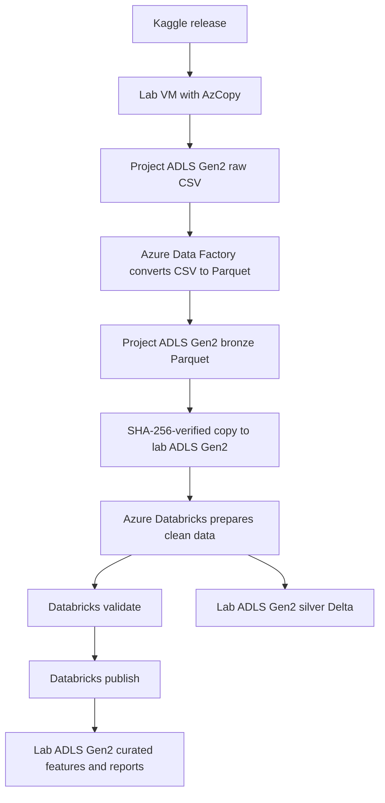

# DSAI3202 Phase 1 Stock Close Forecast

The pipeline takes the Kaggle stock history through versioned ingestion, quality checks, full-population profiling and initial forecasting features. The files to run in Azure are `phase1_pipeline.py`, `project.json` and `fixtures/quality_test.parquet`. The run reports and exported configurations record the deployed Azure pipeline.

## Project and hypothesis

**Phase 0 project:** Forecasting Analysis for Stock Market. The submitted hypothesis reads “Provide investor/seller predictions to buy/sell a stock from which company at which time to increase their gains and lessen their loss, under changeable market stock prices condition.” Daily `Close` was the stated regression target.

**Proposed Phase 1 refinement:** For ticker and trading date *t*, make a prediction once that date’s opening price is available. A regression model that uses the opening price and strictly earlier observations should achieve lower mean absolute error (MAE) for the same date’s `Close` than the baseline **predicted close = opening price** on a held-out chronological test period. Endpoint use would be a pre-close estimate for a user reviewing daily price movements.

The timing makes the experiment testable and avoids using the completed day’s high, low or total volume. The target and source are carried over from Phase 0. Compare both methods on identical test rows and split by dates across all tickers. Use earlier dates for training, the next block for validation and the latest block for testing. Fit preprocessing using training data only. Report MAE as forecasting evidence. A claim about trading gains would need a separate evaluation of trades and costs.

## Dataset and architecture

**Source:** Jake Wright, *9000+ Tickers of Stock Market Data (Full History)*, Kaggle release 2, dated 13 November 2024. The Phase 0 data source, release and regression target are retained. Phase 1 uses the publisher's full **`all_stock_data.csv`** file and converts it to bronze Parquet in ADF.

- [Kaggle dataset page](https://www.kaggle.com/datasets/jakewright/9000-tickers-of-stock-market-data-full-history?select=all_stock_data.csv)
- [Kaggle file listing API](https://www.kaggle.com/api/v1/datasets/list/jakewright/9000-tickers-of-stock-market-data-full-history)

The original CSV has **3,512,208,588 bytes** (3.512 GB uncompressed) and **34,646,258 data records**. The [verified raw handoff receipt](evidence/azure/databricks_lab_handoff.json) records the original CSV path, byte count and SHA-256. Kaggle lists Yahoo as the data source and “Other (specified in description)” as the license in its [metadata](https://www.kaggle.com/api/v1/datasets/metadata/jakewright/9000-tickers-of-stock-market-data-full-history). Keep the original file in Azure and link the publisher from Git.

| CSV columns | Bronze Parquet columns | Clean types |
| --- | --- | --- |
| `Date`, `Ticker` | `Date`, `Ticker` | Date, string |
| `Open`, `High`, `Low`, `Close` | Same names | Double |
| `Volume`, `Dividends`, `Stock Splits` | `Volume`, `Dividends`, `Stock_Splits` | Double |

ADF writes all nine bronze fields as strings. Databricks performs type conversion alongside its row-level gate so casting errors appear in the audit. The underscore in `Stock_Splits` satisfies the ADF Parquet connector's column naming requirement.



Refresh is a manual batch for each selected Kaggle release. The source and ADF conversion run in resource group `rg-dsai3202-jahan-60100358`. The Databricks job runs in workspace `dsai3202-databricks` on the existing Lab 5 compute.

| Azure storage account | Container and location | Contents |
| --- | --- | --- |
| `stockforcasting60100358` | `raw/stock_phase1/releases/<CSV_SHA>/` | Original versioned Kaggle CSV |
| `stockforcasting60100358` | `processed/stock_phase1/bronze_csv/<CSV_SHA>/` | Original ADF bronze Parquet |
| `amazonlake60100358` | `processed/stock_phase1/bronze_csv/<CSV_SHA>/` and `processed/stock_phase1/handoff/<CSV_SHA>/` | Verified Parquet copy, configuration, handoff receipt and quality fixture |
| `amazonlake60100358` | `processed/stock_phase1/silver/` | Clean Delta |
| `amazonlake60100358` | `curated/stock_phase1/project_data/` | Rejected rows, quality reports, EDA, catalog and versioned features |

The VM compares SHA-256 across the two Parquet files. The [handoff receipt](evidence/azure/databricks_lab_handoff.json) connects the original CSV, ADF conversion, and staged Parquet. The [published catalog entry](evidence/azure/job-867374748807312/catalog.json) records schema, key `(ticker, date)`, assumptions, lineage and output paths.

## Run the pipeline

Prerequisites are the course Ubuntu VM, Azure CLI with the Data Factory extension, AzCopy, Python 3, the two ADLS Gen2 accounts in the architecture table, and the course Databricks workspace and Lab 5 compute. The VM uses the course Microsoft Entra login. The author running the VM needs blob data read and write access on the project and lab containers used for staging. Grant the ADF factory's managed identity access to read project `raw` and write project `processed`. The Databricks job's run-as identity needs `READ FILES` and `WRITE FILES` on the existing Unity Catalog external locations for the lab `processed` and `curated` containers.

| Course lab | Procedure reused |
| --- | --- |
| Lab 3 | Use an Ubuntu VM, AzCopy and ADLS Gen2 for content-addressed raw ingestion and verification. |
| Lab 4 | Use ADF Copy to convert the CSV to Parquet. Record the pipeline run ID and copied row count. |
| Labs 5–6 | Use Databricks to cast fields, clean to Delta, validate and publish. Keep rerun and controlled-failure evidence. |
| Lab 7 | Save versioned feature Parquet and a feature definition with key, type and prediction-time rules. |

### 1. Download and ingest the original CSV

Download `all_stock_data.csv` from the Kaggle dataset page to Windows. In the Ubuntu VM, create the destination folders:

```bash
mkdir -p ~/DSAI3202_Stock_Phase1/local-data ~/DSAI3202_Stock_Phase1/evidence/azure
```

From Windows PowerShell, connect with the Lab 3 SSH identity. Substitute your key path, VM user and public IP.

```powershell
sftp -i "YOUR_WINDOWS_SSH_KEY_PATH" YOUR_VM_USER@YOUR_VM_PUBLIC_IP
```

At the `sftp>` prompt, run:

```text
lcd C:/Users/YOUR_WINDOWS_USER/Downloads
cd DSAI3202_Stock_Phase1/local-data
put all_stock_data.csv
```

If the upload is interrupted after the remote file is created, reconnect, open the same folders and run `reput all_stock_data.csv`. Then verify the complete file in Ubuntu:

```bash
cd ~/DSAI3202_Stock_Phase1
printf '%s  %s\n' \
  'f29b6abf161eeb97832f1d7ae918e7fe3b67c54334a342710bdb5c48ccb45f98' \
  'local-data/all_stock_data.csv' | sha256sum -c -
```

Wait for `OK`. Sign in to your course account, set the designated destination and run the upload.

```bash
az login --use-device-code
export SA="stockforcasting60100358"
export STOCK_SHA="$(sha256sum local-data/all_stock_data.csv | cut -d ' ' -f 1)"
set -o pipefail

bash azure/stage_source.sh "$SA" local-data/all_stock_data.csv 2>&1 \
  | tee evidence/azure/raw_upload_first.log
```

Keep the receipt with the SHA-256, bytes and exact Azure path. The upload script uses `--overwrite=false` and verifies the downloaded raw bytes. To demonstrate a safe rerun, use the same SHA and capture the path, ETag, last modified and bytes before and after. Both snapshots should show one CSV and match.

```bash
raw_snapshot() {
  az storage blob list --account-name "$SA" --container-name raw \
    --prefix "stock_phase1/releases/$STOCK_SHA/" --auth-mode login \
    --query "[].{name:name,etag:properties.etag,modified:properties.lastModified,bytes:properties.contentLength}" \
    -o json
}

raw_snapshot > evidence/azure/raw_before_rerun.json
bash azure/stage_source.sh "$SA" local-data/all_stock_data.csv 2>&1 \
  | tee evidence/azure/raw_upload_rerun.log
raw_snapshot > evidence/azure/raw_after_rerun.json
diff -u evidence/azure/raw_before_rerun.json evidence/azure/raw_after_rerun.json
```

### 2. Convert CSV to Parquet in Azure Data Factory

Open the project factory in ADF Studio. Use an ADLS Gen2 linked service named `ls_stock_lake` with its system-assigned managed identity, and test the connection to the **project** lake. The identity needs access to read raw and write processed. If the linked-service name differs, edit both dataset JSON files. Use these commands for the first conversion of a release, when its bronze path is new. For the deployed release, the repository already includes the verified ADF evidence. Save any rerun separately.

```bash
export RG="rg-dsai3202-jahan-60100358"
export FACTORY="adf-dsai3202-60100358"
az extension add --name datafactory

az datafactory dataset create -g "$RG" --factory-name "$FACTORY" \
  --name ds_stock_phase1_csv --properties @azure/adf/dataset.json

az datafactory dataset create -g "$RG" --factory-name "$FACTORY" \
  --name ds_stock_phase1_parquet --properties @azure/adf/parquet_dataset.json

az datafactory pipeline create -g "$RG" --factory-name "$FACTORY" \
  --name pl_stock_phase1_csv_to_parquet --pipeline @azure/adf/pipeline.json

az datafactory pipeline create-run -g "$RG" --factory-name "$FACTORY" \
  --name pl_stock_phase1_csv_to_parquet --parameters "{\"release_sha256\":\"$STOCK_SHA\"}" \
  --query runId -o tsv > evidence/azure/adf_csv_to_parquet_run_id.txt
```

In **ADF Studio → Monitor**, wait for `ConvertCsvToParquet` to succeed. Then save the activity result from the VM in the same shell. The Databricks handoff script reads both evidence files.

```bash
ADF_RUN_ID="$(cat evidence/azure/adf_csv_to_parquet_run_id.txt)"

az datafactory activity-run query-by-pipeline-run \
  -g "$RG" --factory-name "$FACTORY" --run-id "$ADF_RUN_ID" \
  --last-updated-after "$(date -u -d '2 days ago' +%FT%TZ)" \
  --last-updated-before "$(date -u +%FT%TZ)" \
  --query "value[?activityName=='ConvertCsvToParquet'].{status:status,rowsRead:output.rowsRead,rowsCopied:output.rowsCopied,rowsSkipped:output.rowsSkipped,filesWritten:output.filesWritten,dataWritten:output.dataWritten}" \
  -o json > evidence/azure/adf_csv_to_parquet_output.json
```

Check the activity reports **34,646,258 rows read and copied** and one file written. If the query returns an empty list, check the run status and widen the UTC date range to cover the completed run. For the safe-rerun check, start a second run with the same SHA, save its ID separately, and confirm `CheckBronze` reports that the existing Parquet file was found. Keep the full conversion's ID and activity output for the handoff. [ADF consistency verification](https://learn.microsoft.com/en-us/azure/data-factory/copy-activity-data-consistency) · [ADF Parquet connector](https://learn.microsoft.com/en-us/azure/data-factory/format-parquet)

### 3. Stage the ADF Parquet for the Lab 5 Databricks workspace

[Lab 5](https://chatgpt.com/library?file_id=libfile_3e8dc363bcb481919656012d6ae13885&account_id=personal) and [Lab 6](https://chatgpt.com/library?file_id=libfile_4d5f2f2f5364819180a0cebd997e7052&account_id=personal) read and write the existing Lab 3 lake through governed ADLS paths. Use the course workspace `dsai3202-databricks`, your existing `dsai3202-lab5-60100358` compute, and the lab lake `amazonlake60100358`. The project CSV and ADF output stay in the separate project account. The stock notebook reads a byte-verified copy of the ADF Parquet from the lab lake under `processed/stock_phase1/`.

Run the handoff on the Ubuntu VM from the repository root. It uses your Azure CLI login and the evidence already saved by the raw ingestion and ADF steps.

```bash
cd ~/DSAI3202_Stock_Phase1
bash azure/stage_databricks_input.sh stockforcasting60100358 amazonlake60100358
```

The VM account needs read access to the original project blobs and write access to the lab `processed` container. The script checks the raw rerun evidence and ADF row counts, makes one server-side Parquet copy with overwrite disabled, and compares SHA-256 across the two Parquet objects. It downloads one Parquet copy at a time for verification, so allow an additional 2.18 GB of VM disk space. It also uploads the job config, test fixture and handoff receipt to content-versioned paths. The final **`LAB_HANDOFF_READY`** message prints the exact job parameters. Save [the handoff script](azure/stage_databricks_input.sh), the generated `evidence/azure/databricks_lab_handoff.json`, and `evidence/azure/databricks_lab_parameters.json`. [Cross-account AzCopy](https://learn.microsoft.com/en-us/azure/storage/common/storage-use-azcopy-blobs-copy)

If Azure denies access, use the error to identify whether the named account is the project lake or the lab lake. The Databricks workspace uses the existing Unity Catalog access to the lab `processed` and `curated` external locations. File-path listings and JSON reports use `dbutils.fs`, while Spark reads the Parquet and writes the clean data, quarantine and features. [Databricks file utilities](https://learn.microsoft.com/en-us/azure/databricks/dev-tools/databricks-utils)

### 4. Create the Lab 6 Databricks job

In **Compute**, start your existing `dsai3202-lab5-60100358` compute and keep the course policy settings. In **Workspace**, import the updated `phase1_pipeline.py` as a Python notebook under your `DSAI3202_Phase1` folder. In **Jobs & Pipelines**, create the three Notebook tasks below. All three point to that same notebook and attach to that same compute. Keep one concurrent run, zero task retries and no schedule. [Databricks notebook tasks](https://learn.microsoft.com/en-us/azure/databricks/jobs/notebook)

| Task | Task-level `stage` | Dependency |
| --- | --- | --- |
| prepare | `prepare` | Starts first |
| validate | `validate` | prepare succeeded |
| publish | `publish` | validate succeeded |

For each task, set `run_id` to `job-{{job.run_id}}`. Add the job parameters from `evidence/azure/databricks_lab_parameters.json` under `job_parameters`. Set `code_version` to the commit of the deployed notebook. The verified runs used `33458028d49b505c4108a4a4ced12790ca884695`. Use the [exported Databricks job](evidence/azure/databricks-job.yaml) for the actual workspace notebook path, compute and task settings, and [job.example.json](job.example.json) as the setup template.

| Job parameter | Source or value |
| --- | --- |
| `config_path` | Handoff output, versioned project JSON in lab processed |
| `landing_path` | Handoff output, byte-verified stock Parquet in lab processed |
| `handoff_path` | Handoff output, versioned receipt in lab processed |
| `processed_root` | `abfss://processed@amazonlake60100358.dfs.core.windows.net/stock_phase1/silver` |
| `root_path` | `abfss://curated@amazonlake60100358.dfs.core.windows.net/stock_phase1/project_data` |
| `scenario` | `full` |
| `code_version` | Git SHA of the deployed notebook and config |
| `clean_format` | `delta` |
| `adf_run_id` | Handoff output, first successful ADF conversion ID |

**Full run.** Start the job with the defaults. The notebook checks the staged file metadata against the handoff and verifies the Spark input count against all **34,646,258** source rows. Save the run ID, manifest, `quality.json`, `gate.json`, `eda.json`, `run.json` and the published catalog entry. The catalog entry gives the clean Delta and feature Parquet paths. For a Unity Catalog table like in Lab 5, register the completed Delta path with `CREATE TABLE dsai3202_databricks.s_60100358.stock_close_silver USING DELTA LOCATION '<clean Delta path from catalog entry>'` if you have the table-creation grants. The catalog JSON supplies the equivalent documented metadata required for Phase 1.

**Safe rerun.** Run the job with the same inputs and code SHA. The run report should show `ingestion=reused` and `status=reused`, pointing to the same input and output versions and original output paths.

**Controlled failure.** Choose **Run now with different parameters**. Set `scenario=quality_test`, change `landing_path` to `quality_test_landing_path` from the handoff output, and clear `adf_run_id` for that run. Keep `handoff_path` so the notebook can verify the fixture. Prepare should succeed with the quarantine report, validate should reject all four fixture records, and publish should be skipped. [Databricks run overrides](https://learn.microsoft.com/en-us/azure/databricks/jobs/run-now)

The [deployed Databricks job YAML](evidence/azure/databricks-job.yaml) records the task graph and configured parameters. The [deployed ADF pipeline JSON](evidence/azure/adf.pipeline.export.json) records the conversion steps. Export ADF again from the VM with:

```bash
az datafactory pipeline show -g rg-dsai3202-jahan-60100358 \
  --factory-name adf-dsai3202-60100358 \
  --name pl_stock_phase1_csv_to_parquet -o json > evidence/azure/adf.pipeline.export.json
```


### 5. Check locally if needed

Use Python 3.11 or 3.12 and an appropriate Java runtime such as Java 17. The fixture runs locally with Parquet; Azure uses Delta.

```bash
python -m pip install -r requirements-local.txt
python verify_fixture.py
```

To check the CSV conversion and pipeline locally, first use the included PyArrow converter. This reproduces the ADF column and string-type mapping. Use the Azure run as the course submission evidence.

```bash
python local_convert_csv.py local-data/all_stock_data.csv local-output/bronze/all_stock_data.parquet
PYSPARK_SUBMIT_ARGS='--driver-memory 4400m pyspark-shell' python phase1_pipeline.py \
  --config-path project.json --landing-path local-output/bronze/all_stock_data.parquet \
  --preserved-source-path local-data/all_stock_data.csv --root-path local-output \
  --scenario full --run-id local-csv-full-01 --code-version stock-csv-phase1-v1 \
  --local-threads 4 --local-shuffle-partitions 64
```

## Results and features

The pipeline validates keys, labels and required prices. It quarantines nonpositive prices, inconsistent OHLC ranges beyond a small rounding tolerance, negative optional numeric fields, and invalid values. Exact normalized duplicates retain one row. Valid rows that disagree for the same ticker and date are quarantined together. The provisional quality gate fails on zero accepted rows or a reject fraction above **10%**. Review overall and yearly losses when judging fitness for the experiment. Preserve the full input first so early coverage or anomaly investigations remain possible.

### Azure run evidence

| Check | Run and evidence | Result |
| --- | --- | --- |
| Raw ingestion rerun | [Before](evidence/azure/raw_before_rerun.json), [after](evidence/azure/raw_after_rerun.json), [verification log](evidence/azure/raw_upload_rerun.log) | Same versioned CSV path, ETag, last-modified time and byte count. The copy SHA-256 matched. |
| ADF full conversion | `2f2598ba-e1ba-11f1-9bcb-70a8a53d4b1a`, [activity output](evidence/azure/adf_csv_to_parquet_output.json) | 34,646,258 rows read and copied to one bronze Parquet file. |
| ADF safe rerun | `ec38cf96-e1bd-11f1-9bcb-70a8a53d4b1a`, [activity output](evidence/azure/adf_csv_to_parquet_rerun_output.json) | The bronze file already existed, so the conversion was skipped. |
| Databricks full | [`867374748807312`](evidence/azure/job-867374748807312/run.json), [quality](evidence/azure/job-867374748807312/quality.json), [gate](evidence/azure/job-867374748807312/gate.json), [EDA](evidence/azure/job-867374748807312/eda.json) | Published. **34,646,258 input = 33,451,152 accepted + 1,195,106 rejected**. Rejected fraction 3.45%. |
| Databricks safe rerun | [`2326475523307`](evidence/azure/job-2326475523307/run.json) | Reused the original run and output version with the same row counts. |
| Controlled failure | [`849984634809090`](evidence/azure/job-849984634809090/run.json), [quality](evidence/azure/job-849984634809090/quality.json), [gate](evidence/azure/job-849984634809090/gate.json) | 4 input, 0 accepted, 4 rejected. Validation failed on zero accepted records and 100% rejection. Publish was skipped. |

The full run used input version `557cee81744d3f3e75987d974d703488af0fe3c4cb1ee89bb97789404314f5c4`, code version `33458028d49b505c4108a4a4ced12790ca884695`, and output version `e35752aaf4631de76015ac358c1f8c3d96d3ac2314c23c7e2935a3ce7d7137fa`. The fixture has its own input version recorded in the controlled-failure report.

The [catalog entry](evidence/azure/job-867374748807312/catalog.json) records the exact Azure URIs. The paths below are relative to the named containers in `amazonlake60100358`.

| Output | Container and path |
| --- | --- |
| Clean Delta | `processed/stock_phase1/silver/stock_daily/full/job-867374748807312/clean` |
| Versioned feature Parquet | `curated/stock_phase1/project_data/stock_daily/full/runs/job-867374748807312/features_v1` |
| Quarantined rows | `curated/stock_phase1/project_data/stock_daily/full/runs/job-867374748807312/rejected` |

### EDA findings

The quality report covers the full **34,646,258-row** input. The Azure EDA profiled all **33,451,152 accepted rows** across **9,311 tickers** and **15,819 distinct dates**, from **1962-01-02** to **2024-11-04**. The most frequent rejection combined a nonpositive price with inconsistent OHLC values and accounted for **1,191,197** rejected rows.

- The median close was approximately **11.55**, with quartiles at **3.77** and **29.23**. The IQR rule flagged **4,055,707** closing prices. The maximum was approximately **1.51 × 10²⁸**, and the pooled Open–Close Pearson coefficient rounded to **1.0**. Inspect extremes by ticker and check the publisher's adjustment practices before interpreting pooled correlations or MAE.
- **4,537,809** accepted rows had zero volume. Compare model performance for zero-volume and active observations, since their forecasts may have different interpretations.
- `previous_close`, `previous_range_fraction`, and `log_previous_volume` each had **9,311** missing values. The five-observation mean had **46,515** missing values. Compare the model and baseline on identical held-out rows and account for initial missing history.

| Model input | Type | Source and definition | Availability |
| --- | --- | --- | --- |
| `open_price` | Double | Same date's opening price | At prediction time |
| `previous_close` | Double | Latest strictly earlier accepted close for the ticker | After the earlier session closes |
| `mean_close_previous_5` | Double | Mean of five prior accepted closing prices. Null until five are available. | After the preceding sessions close |
| `previous_range_fraction` | Double | Earlier session's `(High − Low) / Close` | After the earlier session closes |
| `log_previous_volume` | Double | `log(1 + Volume)` for the earlier accepted session | After the earlier session closes |

Keep `ticker` and `date` for identification and chronological splitting. The same-day `Close` is stored as `label` for training and evaluation. Same-day High, Low, Volume, Dividends and Stock Splits are retained in clean data and excluded from the features. Earlier valid rows can skip holidays, missing days or quarantined days. Initial lag values remain missing for tickers with little recorded history. Verify whether the release restates historical prices after corporate actions. The dataset fields do not identify currencies, exchanges, or ticker reuse. Evaluate across date periods and ticker groups with these limitations in mind. The historical model-ready rows have a valid completed price bar. A live forecasting service would encounter some missing or suspect bars before it could assess that day’s final label.

## Resource use and contributions

ADF wrote **2,182,524,492 bytes** of Parquet, **37.9% smaller** than the 3,512,208,588-byte CSV. The handoff stores one extra verified Parquet copy to use the course workspace's existing storage access. Reusing published results reduced measured notebook-stage time from **185.256 seconds** on the [full run](evidence/azure/job-867374748807312/run.json) to **4.074 seconds** on the [rerun](evidence/azure/job-2326475523307/run.json). These timings measure the three pipeline stages and exclude cluster startup and task scheduling.

After the checks, terminate the Lab 5 compute and deallocate the VM from the Azure portal. Keep ADF triggers and Data Flow debug off for this manual workflow. Retain the versioned source, outputs and run evidence for instructor access.

Jehan Ali Elsaid verified the source hash, configured Azure storage and ADF, staged the Parquet, set up the three Databricks tasks, and ran and verified the full pipeline, safe rerun and controlled failure. The project follows Lab 3 for versioned ADLS ingestion, Lab 4 for ADF conversion, Lab 5 for Spark cleaning and Delta, Lab 6 for the three-task quality gate and isolated failure test, and Lab 7 for versioned features. The stock-specific schema, reject rules and lagged features adapt those workflows to daily close forecasting.

Submit the repository link and final documentation commit in D2L. Grant the instructor repository access and access to the relevant Azure paths as required by the course. Keep the large source and generated tables in Azure.

## AI use

| Tool | Request | Response | My changes and verification |
| --- | --- | --- | --- |
| ChatGPT | Adapt the Phase 0 stock project into a Phase 1 pipeline and help document the Azure runs. | Drafted the ingestion and ADF setup, Databricks pipeline and features, test fixture, run commands and README. | I configured and ran the Azure resources, checked the raw and Parquet hashes, verified row accounting and the reused output version, and saved the controlled-failure evidence. |
| Databricks Genie Code | Diagnose the Spark Connect write failure. | Identified the unsupported `errorifexists` write-mode spelling on the course compute and updated the three writes to use `error`. | I reviewed the three changes, committed the matching code to Git, and verified the full run, safe rerun and controlled failure using that commit. |
